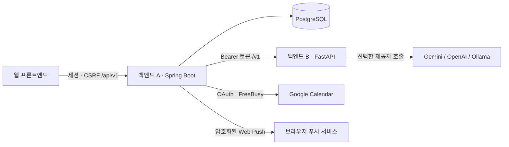

# 솜(SOM) Backend

**하루의 마음과 생활 기록을 돌아보고, 소미와의 대화와 짧은 회복 루틴으로 쉬어가는 웰빙 웹앱의 백엔드입니다.**

솜은 지친 취업 준비생과 사회 초년생이 자신의 상태를 살피고 작은 회복 행동을 시작하도록 돕습니다. 양 캐릭터 **소미**의 레벨과 털 무게로 오늘의 상태를 표현하고, 체크인·수면 기록·대화에 맞는 루틴을 제공합니다.

이 저장소에는 공개 API와 데이터 관리를 담당하는 **Spring Boot 백엔드 A**, 상태 계산·추천·AI 대화를 담당하는 **FastAPI 백엔드 B**가 함께 들어 있습니다. 프론트엔드는 [별도 저장소](https://github.com/2026Ganzi-Thon/2026_GANZITHON_TEAM_01_FE)에서 관리합니다.

> 레벨과 털 무게는 서비스 내부의 상태·회복 지표입니다. 의료 진단이나 실제 건강 개선을 측정하는 수치로 사용하지 않습니다.

## 서비스와 API 문서

| 항목 | 주소 |
| --- | --- |
| 백엔드 | https://som-team-01-api.onrender.com |
| Swagger UI | https://som-team-01-api.onrender.com/swagger-ui/index.html |
| OpenAPI JSON | https://som-team-01-api.onrender.com/v3/api-docs |

GitHub에 올라간 코드와 Render에서 실행 중인 버전은 다를 수 있습니다. 새 API가 보이지 않으면 Render의 배포 커밋과 성공 여부를 확인하세요. Google Calendar·Web Push API는 기능을 활성화한 환경에서만 Swagger에 표시됩니다.

## 주요 기능

| 영역 | 구현 내용 |
| --- | --- |
| 계정 | 아이디·비밀번호 가입, 로그인·로그아웃, 세션 인증, 본인 조회, 닉네임 수정 |
| 동의와 온보딩 | 필수 약관, 데이터 항목별 선택 동의·철회 이력, 온보딩 답변 저장 |
| 하루 체크인 | 마음 상태·스트레스 요인·필요한 도움 기록, KST 기준 하루 단위 저장·재제출 |
| 생활 기록 | 걸음 수·총 수면 시간 수동 입력, 날짜별 조회·수정, 데이터 수신 시 소스별 동의 검사 |
| 홈과 기록 | 오늘 점수·레벨·소미 이미지 키, 이번 주 변화, 최근 7일·30일 기록 |
| 소미 대화 | 날짜별 대화 저장·조회, 하루 첫 인사, AI 답변, 상황별 추천 카드 |
| 루틴 | 오늘 추천 목록, 시작·완료·건너뜀 기록, 중복 완료 방지, 주간 이행 조회 |
| 완료 보상 | 오늘 루틴 전체 완료 시 하루 한 번 레벨 1단계 감소, 최저 1단계 |
| 마음 정리 | 루틴 완료 조건에 따른 잠금, 감정·글 기록, 털 깎기 연출 |
| 캘린더 | Google OAuth 후 기본 캘린더의 오늘 바쁜 시간 조회·저장 |
| 알림 | 알림 시간 설정, Web Push 구독 등록·해제, 예약 체크인 알림 발송 |
| 개인정보 | 연결 철회, 기록 삭제, 탈퇴, 내부 엔진 삭제 실패 재시도 |
| 공통 | 입력 검증, 공통 오류, 요청 ID, 요청 횟수 제한, OpenAPI 문서 |

### 수동 입력과 실제 기기 연동 범위

웹앱에서 걸음 수와 수면 시간을 직접 입력할 수 있도록 백엔드 API를 제공합니다. 걸음 수는 하루 총 걸음 수, 수면 시간은 하루 총 분 단위로 저장합니다. 같은 날짜의 값을 다시 보내면 누적하지 않고 교체합니다.

휴대폰 건강 앱에서 걸음 수나 수면을 자동으로 읽는 클라이언트는 이 저장소에 포함되어 있지 않습니다. 모바일 집계 수신 API는 별도로 있지만, 실제 수집에는 HealthKit·Health Connect 등의 권한을 받아 값을 보내는 클라이언트가 필요합니다.

Google 캘린더는 OAuth 연결 시 **기본 캘린더의 오늘 바쁜 시간**만 가져옵니다. 일정 제목·내용·참석자는 저장하지 않으며, 현재 Google 토큰을 보관하거나 이후 자동 동기화하지 않습니다.

### 소미 레벨과 루틴 완료

- 체크인과 동의한 생활 기록을 바탕으로 B가 점수와 1~4단계를 계산합니다.
- 현재 B 계산은 체크인·수면·휴대폰 사용 시간·캘린더 집계값을 사용합니다. 걸음 수는 저장하지만 현재 B 피로도 계산에는 사용하지 않습니다.
- 입력이 부족하면 점수와 레벨은 `null`입니다.
- 오늘 제공되는 운동 루틴 4개를 모두 완료하면 기본 레벨을 1단계 낮추며, 최저 레벨은 1입니다.
- 점수·털 무게·상태 문구·이미지 키도 변경된 단계에 맞춥니다.
- 일부 루틴만 완료하면 레벨은 유지됩니다. 전체 완료 후 같은 루틴을 다시 완료해도 추가로 차감하지 않습니다.
- 체크인이나 생활 기록을 다시 제출하면 원래 입력과 그날 루틴 전체 완료 여부를 함께 계산합니다. 다음 날에는 그날의 완료 기록으로 새로 판단합니다.
- 루틴 완료 후 프론트는 홈 상태와 오늘 루틴 API를 다시 조회합니다.
- 엔진 장애 시 완료 기록은 저장하고 마지막 정상 상태에 `isStale=true`를 표시합니다. 다음 재계산에 전체 완료 여부가 반영됩니다.

이 변경은 주간·기간 기록에서 읽는 일별 스냅샷에도 반영됩니다. 마음 정리의 털 깎기 연출은 별도 기록입니다.

## 기술 스택

| 구분 | 기술 |
| --- | --- |
| 언어·빌드 | Java, Gradle Wrapper 9.8.2, Python |
| 공개 API | Spring Boot 3.5.16, Spring Web |
| 인증·보안 | Spring Security, HTTP Session, CSRF, Argon2 |
| 데이터 접근 | Spring Data JPA, JdbcTemplate |
| 데이터베이스 | PostgreSQL, Flyway |
| 검증·문서 | Bean Validation, springdoc-openapi 2.10.0 |
| 요청 제한 | Bucket4j 8.22.0 |
| 계산·대화 엔진 | FastAPI 0.162.5, Pydantic 2.14.3, Uvicorn 0.54.0 |
| 엔진 HTTP 통신 | Spring RestClient, Python HTTPX 0.28.1 |
| AI 제공자 | Gemini API, OpenAI Responses API. Ollama 선택 경로도 코드에 포함 |
| 웹 푸시 | web-push-java 5.1.2, VAPID, AES128GCM |
| 테스트 | JUnit 5, Spring Boot Test, MockMvc, Spring Security Test, Python unittest |
| 배포 | Docker 멀티 스테이지 빌드, Render Web Service·PostgreSQL |

Docker 빌드는 JDK 25를 사용하고, Java 컴파일 결과는 `--release 17`을 적용합니다. 실제 실행·개발에는 저장소의 Gradle Wrapper와 JDK 25 조합을 권장합니다. Python 패키지 버전은 [requirements.txt](backend-b/requirements.txt), Java 의존성은 [build.gradle](build.gradle)을 참고하세요.

## 아키텍처



### 백엔드 A

세션 사용자 인증, 동의, 데이터 저장·삭제, 공개 응답과 요청 제한을 담당합니다. 피로도 계산과 추천은 B에 요청하고, 결과를 검증해 스냅샷으로 저장합니다. 엔진이 실패하면 기존 결과에 오래된 상태 표시를 붙이고, 기존 값도 없으면 조회에 따라 `503`을 반환합니다.

### 백엔드 B

상태 계산, 변화 요약, 루틴 순서 선정, AI 대화, 털 깎기 연출 판단을 담당합니다. 식별자는 내부 가명 키를 사용합니다. 루틴 선택과 첫 인사는 규칙·템플릿 기반이고, 사용자 메시지 답변은 환경변수로 선택한 AI 제공자를 사용합니다.

Render에서는 하나의 Docker 컨테이너 안에서 A와 B를 실행합니다. 외부 요청은 A가 받고 B는 `127.0.0.1:8000`에 바인딩합니다.

## 디렉터리 구조

```text
.
├── src/main/java/com/som/
│   ├── auth/          # 계정·세션·CSRF·CORS
│   ├── consent/       # 필수·선택 동의
│   ├── connection/    # 데이터 수신·수동 입력·캘린더
│   ├── checkin/       # 하루 체크인
│   ├── state/         # 상태 스냅샷·기록 조회·재계산
│   ├── chat/          # 대화 저장·첫 인사·추천 카드 응답
│   ├── routine/       # 루틴 추천·수행 기록
│   ├── journal/       # 마음 정리·털 깎기 기록
│   ├── settings/      # 온보딩·알림 설정·웹 푸시
│   ├── account/       # 본인 정보·데이터 삭제·탈퇴
│   ├── recovery/      # 익명 공유
│   ├── engine/        # B 계약·Mock·HTTP 클라이언트
│   └── common/        # 오류·시간·로그·요청 제한
├── src/main/resources/
│   ├── application.yml
│   └── db/migration/  # Flyway 마이그레이션
├── src/test/          # Java 단위·통합·시나리오 테스트
├── backend-b/
│   ├── som_engine/    # FastAPI·계산·추천·AI 응답
│   ├── tests/         # 외부 AI 가짜 응답·회복 계산 테스트
│   └── requirements.txt
├── deploy/            # Render 시작 스크립트
├── docs/              # 설계·개발·연동 가이드
├── spec/              # 기능·API 명세
├── Dockerfile
├── render.yaml
└── .env.example
```

## 배포 환경과 설정

사용자와 프론트엔드는 Render의 공개 백엔드 주소에 접근합니다.
Render의 `som-team-01-api` 서비스에서 환경변수를 설정하고, 배포 완료 후 운영 Swagger로 API를 확인합니다.

| 항목 | 배포 구성 |
| --- | --- |
| 공개 API | `https://som-team-01-api.onrender.com/api/v1` |
| 런타임 | Docker 컨테이너 안의 Spring Boot A와 FastAPI B |
| 데이터베이스 | Render PostgreSQL |
| 엔진 모드 | `SOM_ENGINE_MODE=real` |
| 대화 AI | `SOM_CHAT_MODEL_PROVIDER=gemini`로 선택 |
| 인증 | HTTPS 세션 쿠키와 CSRF 토큰 |
| 허용 출처 | `SOM_CORS_ALLOWED_ORIGINS`에 실제 프론트 배포 도메인 등록 |

### Render 환경변수 입력

1. Render Dashboard에서 `som-team-01-api`를 선택합니다.
2. **Environment → Add Environment Variable**에서 필요한 값을 추가합니다.
3. **Save, rebuild, and deploy**로 설정을 적용합니다.
4. **Events**에서 배포 커밋과 `Live` 상태를 확인합니다.

환경변수는 저장소에 코드가 올라가는 것만으로 자동 생성되지 않습니다.
`.env.example`은 설정할 변수의 참고 목록이며, 실제 키와 비밀번호는 Render에 입력합니다.
아래 항목은 배포용 DB·인증 설정입니다.

| 변수 | 용도 |
| --- | --- |
| `SOM_DB_HOST`, `SOM_DB_PORT`, `SOM_DB_NAME` | Render PostgreSQL 접속 주소·포트·DB 이름 |
| `SOM_DB_USER`, `SOM_DB_PASSWORD` | PostgreSQL 계정 |
| `SOM_ENGINE_TOKEN` | A와 B 사이의 내부 요청 인증 |
| `SOM_CORS_ALLOWED_ORIGINS` | 실제 프론트 출처. 여러 개면 쉼표로 구분 |
| `SOM_SESSION_COOKIE_SAME_SITE` | 교차 사이트 구성에서 `none` |
| `SOM_CSRF_CROSS_SITE` | 교차 사이트 구성에서 `true` |

시작 스크립트가 Render DB 변수로 JDBC URL을 구성합니다.
공개 웹 요청은 A가 받고, B는 컨테이너 내부에서만 접근하도록 실행합니다.

## AI 제공자 설정

한 메시지에는 선택한 제공자 하나만 호출합니다. 대화 호출의 기존 JSON 형식과 루틴 추천 카드는 제공자를 바꿔도 유지됩니다.

| 변수 | 용도 |
| --- | --- |
| `SOM_CHAT_MODEL_PROVIDER` | `gemini`, `openai`, `ollama` 중 선택. 기본 `ollama` |
| `SOM_CHAT_SEND_USER_TEXT_TO_ENGINE` | `true`이면 A가 사용자 대화 원문을 B에 전달. 기본 `false` |
| `GEMINI_API_KEY` | Gemini 키 |
| `SOM_GEMINI_MODEL` | Gemini 모델. 기본 `gemini-3.5-flash-lite` |
| `OPENAI_API_KEY` | OpenAI 키 |
| `SOM_OPENAI_MODEL` | OpenAI 모델. 기본 `gpt-4.1-mini` |
| `SOM_OLLAMA_MODEL` | Ollama 선택 경로에서 사용할 모델 이름. 현재 Render 시작 스크립트에는 Ollama 실행이 포함되지 않음 |

Gemini 사용 예시는 다음과 같습니다.

```dotenv
SOM_ENGINE_MODE=real
SOM_CHAT_MODEL_PROVIDER=gemini
SOM_GEMINI_MODEL=gemini-3.5-flash-lite
GEMINI_API_KEY=your_gemini_api_key
SOM_CHAT_SEND_USER_TEXT_TO_ENGINE=true
```

- Gemini·OpenAI 경로에는 현재 사용자 메시지와 소미 시스템 지침을 전달합니다. 과거 대화 전체를 보내는 구현은 아닙니다.
- 현재 Render Docker 설정에는 Ollama 설치·실행이 포함되지 않으므로 배포에서는 외부 AI 제공자를 설정합니다.
- 첫 인사는 주간 기록 기반 템플릿이고, 추천 루틴은 기존 목록을 조건에 따라 정렬합니다.
- 위험 표현은 규칙과 모델의 분류 결과로 처리하고, 출력 문구도 검증합니다.
- 키 누락·외부 API 오류·차단·형식 오류 시 기존 템플릿 답변으로 돌아갑니다.
- 외부 AI로 대화를 전송하는 사실을 서비스 안내·동의에 반영하고 제공업체의 데이터 처리 조건을 확인해야 합니다.
- API 키는 서버 환경변수에만 저장합니다. ChatGPT·Gemini 앱 구독과 API 이용 조건은 각각 확인하세요.

## 공개 API 사용

기본 경로는 `/api/v1`입니다. 요청 형식과 전체 응답 스키마는 Swagger를 기준으로 확인하세요.

### 인증과 CSRF

1. `GET /api/v1/auth/csrf`를 호출합니다.
2. 응답의 `headerName`과 `token`을 사용해 변경 요청에 해당 헤더를 넣습니다.
3. 가입 또는 로그인 요청 후 세션 쿠키를 유지합니다.
4. 가입 후 필수 동의를 저장하고, 필요한 데이터 항목만 선택 동의합니다.
5. 인증 과정에서 토큰이 갱신될 수 있으므로 이후 변경 요청 전에 CSRF 토큰을 다시 가져옵니다.

브라우저에서 서로 다른 도메인을 연결할 때는 쿠키 전송과 CORS 허용 출처를 함께 설정해야 합니다. 프론트 요청은 `credentials: 'include'`가 필요하며, 필요한 경우 같은 출처의 API 프록시를 사용합니다.

### 주요 엔드포인트

| 영역 | 메서드 | 경로 |
| --- | --- | --- |
| 가입·로그인·로그아웃 | POST | `/auth/signup`, `/auth/login`, `/auth/logout` |
| 본인 조회·닉네임 | GET / PATCH | `/me` |
| 필수 동의 | GET / PATCH | `/me/consents` |
| 항목별 연결 | GET | `/me/connections` |
| 동의·철회 | POST / DELETE | `/me/connections/{source}` |
| 온보딩 | GET / PUT | `/me/onboarding` |
| 체크인 제출 | POST | `/checkins` |
| 체크인 조회 | GET | `/checkins?date={YYYY-MM-DD}` |
| 오늘 상태 | GET | `/state/today` |
| 주간·기간 기록 | GET | `/insights/week`, `/insights?days=7`, `/insights?days=30` |
| 대화 전송 | POST | `/chat/messages` |
| 날짜별 대화 | GET | `/chat/messages?date={YYYY-MM-DD}` |
| 대화 날짜 목록 | GET | `/chat/dates` |
| 추천 카드 응답 | POST | `/chat/recommendations/{messageId}/response` |
| 오늘 루틴 | GET | `/routines/today` |
| 루틴 실행 | POST | `/routines/{routineId}/start`, `/routines/{routineId}/complete`, `/routines/{routineId}/skip` |
| 마음 정리 저장 | POST | `/journal` |
| 마음 정리 조회 | GET | `/journal?date={YYYY-MM-DD}` |
| 수동 기록 조회 | GET | `/me/manual-signals/{date}` |
| 걸음 수 저장 | PUT | `/me/manual-signals/{date}/steps` |
| 수면 시간 저장 | PUT | `/me/manual-signals/{date}/sleep` |
| 알림 설정 | GET / PATCH | `/me/notification-settings` |
| 기록 삭제·탈퇴 | DELETE | `/me/data`, `/me` |
| 삭제 상태 | GET | `/me/deletion-status` |
| 도움 기관 | GET | `/help-resources` |

### 수동 입력 예시

먼저 로그인과 필수 약관 동의를 완료하고 `POST /me/connections/STEPS`, `POST /me/connections/SLEEP`으로 해당 항목에 동의합니다.

```http
PUT /api/v1/me/manual-signals/2026-11-20/steps
Content-Type: application/json

{"total":4321}
```

```http
PUT /api/v1/me/manual-signals/2026-11-20/sleep
Content-Type: application/json

{"total":435}
```

수면 435분은 7시간 15분입니다. 수면 입력은 0~1440분, 걸음 수는 0 이상의 정수이며, 미래 날짜는 저장할 수 없습니다. 날짜별 조회는 아래 형태로 반환합니다.

```json
{
  "steps": 4321,
  "sleepMinutes": 435
}
```

기록이 없거나 해당 소스에 동의하지 않았다면 값은 `null`입니다. 수동 기록 조회는 직접 입력한 출처의 값만 반환합니다.

### 공통 응답 규칙

- 날짜와 일별 처리 기준은 `Asia/Seoul`입니다.
- 외부 사용자 ID를 받지 않고 로그인 세션의 사용자로 조회·변경합니다.
- 입력이 없으면 `null`을 사용하고 임의의 기본 점수로 바꾸지 않습니다.
- 체크인 재제출과 루틴 중복 완료에 대한 멱등성을 처리합니다.
- 삭제·탈퇴는 `{"confirm":true}` 확인 바디가 필요합니다.
- 요청 제한 초과는 `429`와 `Retry-After` 헤더를 반환합니다.
- 공개 API는 입력 오류에 `400`을 사용합니다. 내부 B API는 검증 오류에 `422`를 반환합니다.
- 오류 응답에는 `error.code`, `error.message`, `error.requestId`가 포함됩니다.

## Google 캘린더와 웹 푸시

### Google 캘린더

Render 또는 실행 환경에 아래 변수를 설정합니다.

```dotenv
SOM_GOOGLE_CALENDAR_ENABLED=true
SOM_GOOGLE_CALENDAR_CLIENT_ID=your_client_id
SOM_GOOGLE_CALENDAR_CLIENT_SECRET=your_client_secret
SOM_GOOGLE_CALENDAR_REDIRECT_URI=https://your-web-app.example/google-callback
```

프론트가 연결 시작 API를 호출하고 Google 승인 페이지로 이동한 뒤, 웹 콜백에서 `code`와 `state`를 백엔드로 보냅니다. 해당 Redirect URI는 Google OAuth 클라이언트에 등록된 값과 같아야 합니다.

자세한 요청 순서와 모바일 집계 수신 API는 [캘린더 연동 가이드](docs/MOBILE_AND_CALENDAR.md)를 참고하세요.

### Web Push

```dotenv
SOM_WEB_PUSH_ENABLED=true
SOM_WEB_PUSH_PUBLIC_KEY=your_vapid_public_key
SOM_WEB_PUSH_PRIVATE_KEY=your_vapid_private_key
SOM_WEB_PUSH_SUBJECT=mailto:your-team@example.com
```

웹앱에서 알림 권한을 받고 구독을 등록해야 합니다. 서버는 알림 설정 시간에 맞춰 기기별 하루 한 번 발송을 시도합니다. 프론트 서비스 워커가 수신과 알림 표시를 처리합니다.

현재 구현은 서버가 켜져 있을 때 동작하며, 예정 시각을 5분 넘겨 복구한 경우 당일 발송을 건너뜁니다. 실패한 알림을 같은 날 재시도하는 발송 큐는 없습니다. Render 무료 인스턴스가 쉬는 동안 예약 작업도 멈추므로 지속적인 예약 알림 운영에는 실행 환경을 고려해야 합니다.

상세 설정과 프론트 연결 순서는 [웹 푸시 가이드](docs/WEB_PUSH.md)를 참고하세요.

## 배포 후 검증

`main`에 푸시한 커밋이 실제 서비스에 적용됐는지는 Render의 배포 결과와 공개 API 응답으로 확인합니다.

1. **Events**에서 대상 커밋의 배포가 `Live`인지 확인합니다.
2. 운영 Swagger를 새로 열어 필요한 API가 표시되는지 확인합니다.
3. 검증용 계정으로 가입·필수 동의·로그인을 수행합니다.
4. 체크인 또는 수동 생활 기록을 저장하고 같은 계정으로 다시 조회합니다.
5. 대화 API에 가상의 메시지를 보내 소미의 답변과 추천 카드를 확인합니다.
6. 레벨이 2 이상인 상태에서 일부 루틴을 완료해 레벨이 유지되는지 확인하고, 오늘 운동 루틴 4개를 모두 완료한 뒤 홈에서 1단계 감소와 이미지 키 변화를 확인합니다.
7. 같은 루틴을 다시 완료해 추가 차감이 없는지 확인합니다.
8. 검증용 계정의 데이터와 계정을 정리합니다.

캘린더는 실제 Google OAuth 승인과 웹 콜백까지, 푸시는 지원 기기의 알림 수신까지 확인해야 합니다.
서버 코드의 테스트 통과와 실제 배포 검증은 각각 확인합니다.

### 테스트 구성

Java 테스트는 인증·CSRF·계정 간 접근 제어·동의·삭제·수동 기록·엔진 계약·루틴 레벨 변화를 검증합니다.
Python 테스트는 외부 AI의 가짜 HTTP 응답을 사용해 공급자별 정상 응답·오류·차단·추천 카드와 회복 계산을 검증합니다.

Docker 빌드는 `bootJar`를 실행하며 테스트를 실행하지 않습니다.
테스트 소스는 저장소에서 관리하고, 테스트 결과·보고서·로그 등의 생성물은 Git에서 제외합니다.

## Render 배포

1. Render에서 이 저장소의 `main`과 Docker 런타임을 연결합니다.
2. [render.yaml](render.yaml)의 PostgreSQL 설정 또는 별도로 준비한 PostgreSQL을 연결합니다.
3. DB 호스트·포트·이름·계정·비밀번호와 내부 엔진 토큰을 설정합니다.
4. 선택할 AI 제공자의 키와 대화 전달 옵션, 필요한 선택 기능의 환경변수를 설정합니다.
5. 프론트의 실제 출처를 `SOM_CORS_ALLOWED_ORIGINS`에 등록합니다.
6. 빌드·배포 완료 후 Events의 커밋과 Swagger의 API 목록을 확인합니다.

Dockerfile은 Java 애플리케이션을 빌드하고 Python 엔진을 함께 설치합니다. 시작 스크립트는 Render DB 정보로 JDBC URL을 만들고 A와 B를 실행합니다. Docker 기본 엔진 모드는 `real`입니다.

배포 스크립트가 사용하는 DB 변수는 다음과 같습니다.

```dotenv
SOM_DB_HOST=your_database_host
SOM_DB_PORT=5432
SOM_DB_NAME=your_database_name
SOM_DB_USER=your_database_user
SOM_DB_PASSWORD=your_database_password
SOM_ENGINE_TOKEN=your_internal_engine_token
```

Render 설정은 교차 사이트 쿠키 사용을 위해 `SOM_SESSION_COOKIE_SAME_SITE=none`, `SOM_CSRF_CROSS_SITE=true`를 사용합니다. 프론트 도메인이 바뀌면 CORS 허용 출처도 함께 갱신해야 합니다.

커밋 전에 코드 테스트를 확인하고, 배포 후에는 위 검증 절차로 공개 API 동작을 확인하세요.

## 구현 범위와 확인할 사항

- 아이디·비밀번호 찾기, 휴대폰 건강 데이터 자동 수집 클라이언트는 구현 범위에 포함되지 않습니다.
- Google 캘린더는 기본 캘린더의 오늘 바쁜 시간을 조회하는 방식이며 기기 로컬 캘린더 전체를 읽지 않습니다.
- 실제 캘린더 연동과 푸시 수신은 외부 설정·권한·프론트 연결 후 기기에서 확인해야 합니다.
- Render 앞단 프록시 환경에서 로그인·가입의 IP별 요청 제한에 사용할 신뢰 가능한 사용자 IP 판별은 추가 정리가 필요합니다. 아이디별 로그인 제한과 사용자별 제한은 별도입니다.
- 피로도 산식, 일부 문구·보존 정책·제한값의 미확정 항목은 코드와 명세의 `TODO(DECISION)`을 확인하세요.

## 추가 문서

- [API·기능 명세](spec/A_SPEC.md)
- [아키텍처](docs/ARCHITECTURE.md)
- [기술 결정 기록](docs/ADR.md)
- [개발 규칙](docs/DEVELOPMENT_RULES.md)
- [캘린더·모바일 데이터 연결](docs/MOBILE_AND_CALENDAR.md)
- [웹 푸시](docs/WEB_PUSH.md)
- [개발 기록](WORKLOG.md)
